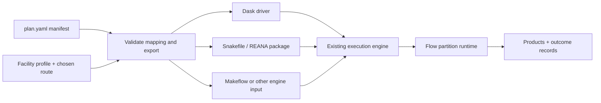

# FAST-HEP Distributed

WORK IN PROGRESS: This is a work-in-progress project. The API and features are not yet stable.

**fasthep-distributed aims to connect compiled FAST-HEP analysis plans to existing execution systems.**
It validates how `plan.yaml` (the analysis plan from fasthep-flow compilation step) maps to a chosen compute facility and exports a standalone, engine-native execution bundle.

Export specifications describe supported features and requirements, making incompatible mappings explicit before execution. Bundles include the plans, analysis configuration, runtime environment description and launch instructions, with external dependencies declared. They provide a reproducible artifact for execution, inspection and debugging.

Existing engines manage scheduling and resources; Flow’s runtime executes the analysis partitions.



*The diagram shows the intended architecture and illustrative export targets; individual integrations remain subject to compatibility studies and implementation.*

## Development

Install the local Pixi environment:

```bash
pixi install
```

Run the baseline checks:

```bash
pixi run test
pixi run lint
pixi run typecheck
pixi run docs-build
```
